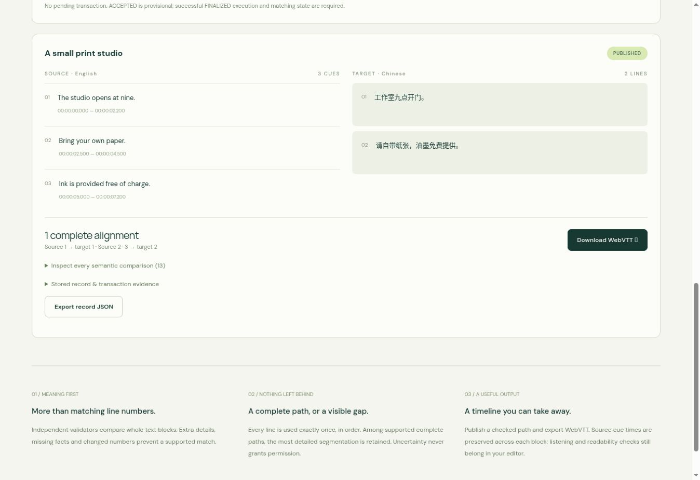

# Network and browser evidence

[Open CueLoom](https://chongqianli7.github.io/cueloom-genlayer/) · [Contract](https://explorer-studio.genlayer.com/address/0x156876241289D62940B5a45677140E292DB6F3A6)

Stable Studionet, chain ID 61999, full consensus (`leaderOnly: false`). The deployed source retrieved with `getContractCode` matched `contracts/cueloom.py` byte for byte; `protocol()` returned `cueloom-1`.

Source SHA-256: `2278d24ced00e4cdcf324eeda6b3e2c17ff7e46a961d8c11d8f72ff99523d53c`.

## Complete subtitle publication

The authored English/Chinese reel `studio-01` has three source cues and two target lines. Consensus accepted the complete 13-label vector; deterministic alignment found the unique finest path `[0,9]`: source 1 → target 1, source 2–3 → target 2. Publication stored that exact path and two-cue WebVTT. The second cue spans 2500–7200 ms. All target text is preserved without generation.

The downloaded [WebVTT](evidence/studio-01.vtt) matches the stored content byte for byte. SHA-256: `9aa17bf704ab5c694c94ac239b3691c8ca983522918845d1a62c5b055961ee0c`.

## Omission blocks publication

The authored reel `browser-gap-02` omits the free-ink detail. Sealing and semantic alignment were submitted through the application in a local browser preview using a disposable browser test signer. The application verified finalized execution, sender/contract/calldata identity and stored state after each call. The semantic transaction itself succeeded; its business result was BLOCKED, with no complete path and no VTT. The browser offered no publish action and cleared the pending guard.

The actual downloaded [browser export](evidence/browser-export.json.gz) contains the same blocked record, its finalized alignment receipt and `pending: null`. The public GitHub Pages application was separately opened, read the PUBLISHED example without a wallet, and downloaded the WebVTT above. The preview and public application use the same source; preview writes are not claimed as public-domain writes.

## Verified transactions

| Operation | Transaction | Finality / execution / consensus |
| --- | --- | --- |
| deployment | [0x4abf84b7e5…](https://explorer-studio.genlayer.com/tx/0x4abf84b7e560fc0780525b1f2e66b16f3559daba30452a095055c92fbcaaaf14) | FINALIZED / SUCCESS / MAJORITY_AGREE |
| seal | [0xae30af21a7…](https://explorer-studio.genlayer.com/tx/0xae30af21a70fd85d4e1738e2f640feb26945e82d190140b2d8d416582aec96e6) | FINALIZED / SUCCESS / MAJORITY_AGREE |
| align | [0x673174680c…](https://explorer-studio.genlayer.com/tx/0x673174680cc92b131e045f2f030ded639cffefceb1da5ffe2d6b25044f156acb) | FINALIZED / SUCCESS / MAJORITY_AGREE |
| publish | [0xb7b21dceda…](https://explorer-studio.genlayer.com/tx/0xb7b21dceda6427fd6285fe77edf679103af85945cc4996791a92e0c4b68c6530) | FINALIZED / SUCCESS / MAJORITY_AGREE |
| seal | [0xf6e70ef122…](https://explorer-studio.genlayer.com/tx/0xf6e70ef1226684cb4575a275b327cc112e5ee9216f60c34559b7ca828d960c41) | FINALIZED / SUCCESS / MAJORITY_AGREE |
| align | [0x40026bc3ed…](https://explorer-studio.genlayer.com/tx/0x40026bc3ed70daf9286f9ac1f411f2d260299e97f2eba597724fffa6d58b63bd) | FINALIZED / SUCCESS / MAJORITY_AGREE |

Raw receipts are preserved as `evidence/<hash>.json.gz`; decompress without modifying their JSON contents. [Publication state](evidence/studio-01.json), [blocked state](evidence/browser-gap-02.json), [verification report](evidence/verification.json) and [deployment manifest](deployment.json) retain the public references. `node scripts/verify-evidence.mjs` checks source hash, finalized receipt identity and calls, exact semantic paths, input/alignment hashes, VTT bytes and browser export. It is offline and sends no transactions.

A supplementary [sealed record](evidence/browser-missing-01.json) is retained as a state-only observation. Its original receipt is not included, and it is excluded from the six verified transactions above. It has no publication claim.

## Scope and limits

Eight mocked-host Python tests and four JavaScript tests passed. They cover merging, full ordered coverage, uncertainty, omitted text, reversal, disagreement on unused matrix cells, owner/hash/path guards, terminal publication, timing/markup checks, and provisional-versus-finalized receipts. They do not execute GenVM or live models. `npm run build` succeeds with Vite's advisory warning for a JavaScript chunk larger than 500 kB.

All subtitle inputs are authored test data. Real network consensus does not establish a real film, authenticated source timing or professional translation accuracy. Validators agreed by majority, not necessarily unanimity. Browser test signing was verified; external wallet-extension signing, physical mobile devices, audio/video synchronization and reading speed were not verified. Responsive layout rules are included. The application deliberately limits tracks to four units each and excludes 2:2 or larger block matches.

